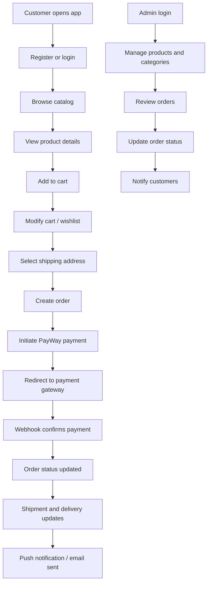
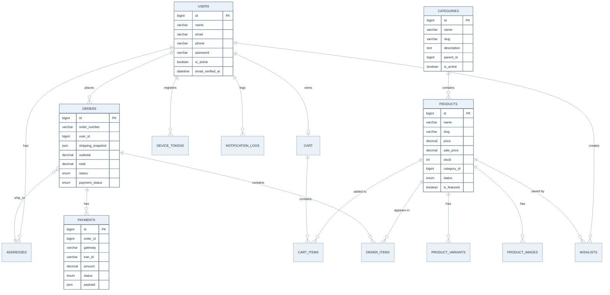

# Laravel 11 E-Commerce REST API

Production-ready e-commerce REST API built with **Laravel 11**, **PHP 8.3**, **MySQL 8**, and **Redis**.
Features Sanctum authentication, role-based access (Spatie Permission), ABA PayWay payments,
Firebase Cloud Messaging, queued jobs (Horizon), and a clean service-layer architecture.

## Stack

- Laravel 11 / PHP 8.3
- MySQL 8 + Redis (cache + queue + rate-limits)
- Laravel Sanctum (token auth, 7-day expiry, rotation on refresh)
- Spatie Laravel Permission (roles: `admin`, `customer`)
- Laravel Horizon (queue dashboard)
- ABA PayWay (sandbox / production)
- Firebase Cloud Messaging (`kreait/laravel-firebase`)

## Project structure

```
app/
├── Events/                       OrderStatusChanged, PaymentConfirmed, OrderShipped, NewPromotion
├── Exceptions/ApiExceptionRenderer.php
├── Http/
│   ├── Controllers/Api/V1/
│   │   ├── Auth/                 AuthController, DeviceTokenController
│   │   ├── Customer/             ProductController, CategoryController, CartController, WishlistController, AddressController, OrderController
│   │   ├── Admin/                AdminProductController, AdminCategoryController, AdminOrderController
│   │   └── Payment/              PayWayWebhookController
│   ├── Middleware/               ForceJsonResponse, EnsureWebhookFromTrustedIp
│   ├── Requests/                 Auth, Product, Cart, Address, Order
│   └── Resources/                User, Product, Category, Cart*, Address, Order*, Payment, Wishlist
├── Jobs/                         SendFCMNotification, SendOrderEmail, ProcessWebhook
├── Listeners/                    SendOrderStatusNotification, SendPaymentConfirmedNotification, BroadcastNewPromotion
├── Models/                       User, DeviceToken, Category, Product, ProductVariant, ProductImage,
│                                 Cart, CartItem, Wishlist, Address, Order, OrderItem, Payment, NotificationLog
├── Providers/                    AppServiceProvider, AuthServiceProvider, EventServiceProvider, RouteServiceProvider, HorizonServiceProvider
├── Services/                     PayWayService, FCMService, CartService, OrderService
└── Traits/                       ApiResponse
config/                           payway.php, fcm.php, firebase.php, sanctum.php, permission.php, horizon.php, queue.php, cache.php, mail.php, …
database/
├── migrations/                   users, password_resets, sessions, cache, jobs, personal_access_tokens, permission tables,
│                                 device_tokens, categories, products, product_variants, product_images,
│                                 carts, cart_items, wishlists, addresses, orders, order_items, payments, notification_logs
└── seeders/                      DatabaseSeeder, RolePermissionSeeder, UserSeeder, CategorySeeder, ProductSeeder
postman/                          ECommerce-API.postman_collection.json, ECommerce-API.postman_environment.json
routes/                           api.php, web.php, console.php
```

## Project overview and business flow

This API powers a complete e-commerce platform with a public storefront and a protected admin dashboard. The system supports browsing products, adding items to a cart, placing orders, making payments, tracking fulfillment, and sending customer notifications.

### Main user roles

- Customer: register/login, manage cart, wishlist, addresses, orders, payment, and profile.
- Admin: manage products, categories, banners, orders, and business content.
- System: payment gateway callbacks, queue workers, and notification dispatchers.

### User flow diagram



### Database structure overview


### Business logic summary

- Catalog browsing is public and supports category filtering, search, and price-range queries.
- All authenticated customer endpoints are protected with Sanctum and rate-limited API throttling.
- Cart items are stored per user and mapped to products and variants.
- Orders keep a shipping snapshot and financial snapshot to preserve historical accuracy.
- Payment records are stored separately from orders so the payment gateway response and order lifecycle can be audited.
- Notifications are triggered when order/payment events happen, and payment failures or cancellations are tracked.
- Admin users can manage content and order states with role guards and allowed status transition rules.

## Environment

A single `.env` file drives behaviour through `APP_ENV`:


| Env          | PayWay     | FCM           | Mail            |
| ------------ | ---------- | ------------- | --------------- |
| `local`      | Sandbox    | Sandbox / dry | Mailtrap (SMTP) |
| `staging`    | Sandbox    | Production    | Real SMTP       |
| `production` | Production | Production    | Real SMTP       |

`config/payway.php` and `config/fcm.php` automatically resolve the correct mode
based on `APP_ENV` and explicit `PAYWAY_MODE` / `FCM_MODE` overrides.

## Setup

```bash
cp .env.example .env
composer install
php artisan key:generate

# 1. Database
php artisan migrate --seed

# 2. Storage symlink (for product images uploaded locally)
php artisan storage:link

# 3. Workers
php artisan horizon          # queue worker + dashboard at /horizon
php artisan serve            # dev API at http://localhost:8000
```

Default seeded credentials:


| Role                 | Email                 | Password       |
| -------------------- | --------------------- | -------------- |
| Admin                | admin@example.com     | `Admin123!`    |
| Admin (local seeder) | admin168168@gmail.com | `Admin123!`    |
| Customer             | customer@example.com  | `Customer123!` |

Note: the project seeder intentionally ensures the admin account exists as `admin@example.com`, and the custom local account `admin168168@gmail.com` is also promoted to the admin role in the `UserSeeder` logic.

## Docker deployment

This project includes Docker configuration for both local development and production deployment.

### Development environment

```bash
# 1. Copy the development environment file
cp .env.docker .env

# 2. Build and start the containers
make dev-build
make dev-up

# 3. Access the application
# API: http://localhost:8000
# MySQL: localhost:3306 (or 3307 in the compose port mapping)
# Redis: localhost:6379
```

The development stack runs the Laravel app, Nginx, MySQL, Redis, and Horizon queue worker.

### Production environment

```bash
# 1. Copy your production environment file (for example .env.prod) to .env
cp .env.prod .env

# 2. Update the .env file with your real values:
# - APP_KEY (generated with php artisan key:generate)
# - DB_PASSWORD
# - PAYWAY credentials
# - FCM credentials

# 3. Build and bring up the production services
make prod-build
make prod-up
```

### Common Docker commands

| Command | Description |
| ------- | ----------- |
| `make dev-build` | Build dev containers |
| `make dev-up` | Start the dev environment |
| `make dev-down` | Stop the dev environment |
| `make dev-logs` | View dev logs |
| `make prod-build` | Build prod containers |
| `make prod-up` | Start the prod environment |
| `make prod-down` | Stop the prod environment |
| `make prod-logs` | View prod logs |
| `make migrate` | Run migrations |
| `make seed` | Run seeders |
| `make optimize` | Cache config/routes/views |
| `make clean` | Remove all containers and volumes |
| `make shell` | Open a shell inside the app container |

### Manual Docker commands

```bash
# Development
docker-compose build
docker-compose up -d
docker-compose exec app php artisan key:generate
docker-compose exec app php artisan migrate:fresh --seed

# Production
docker-compose -f docker-compose.prod.yml build
docker-compose -f docker-compose.prod.yml up -d
```

### Services

- **App**: Laravel PHP-FPM on port `9000` internally, exposed via Nginx at `http://localhost:8000`
- **Nginx**: Web server on port `80` inside Docker, mapped to `localhost:8000`
- **MySQL**: Database on port `3306` inside Docker, mapped to `localhost:3307` in the dev compose file
- **Redis**: Cache/queue backend on port `6379`
- **Horizon**: Queue worker process for Laravel jobs

### Troubleshooting

```bash
# Inspect container logs
docker-compose logs

# Rebuild containers without the Docker cache
docker-compose build --no-cache

# Check MySQL readiness
docker-compose logs db

# Restart services
docker-compose restart
```

If you need to clear the Docker data volumes completely:

```bash
make clean
```

### Production HTTPS

For HTTPS in production, configure your SSL certificate paths in `nginx.conf` and enable the certificate lines in `Dockerfile.nginx` before deploying to a public environment.

## Response envelope

```jsonc
// Success
{ "success": true,  "message": "", "data": {}, "meta": {} }

// Error
{ "success": false, "message": "", "errors": {}, "code": "VALIDATION_FAILED" }
```

All controllers extend `Controller` which uses the `ApiResponse` trait
(`ok()`, `created()`, `error()`). All exceptions are mapped to this shape
by `App\Exceptions\ApiExceptionRenderer`.

## API summary (prefix `/api/v1`)

### Auth


| Method | Path                    | Notes                         |
| ------ | ----------------------- | ----------------------------- |
| POST   | `/auth/register`        | Public                        |
| POST   | `/auth/login`           | Throttled`5/min`              |
| POST   | `/auth/logout`          | `auth:sanctum`                |
| POST   | `/auth/refresh`         | `auth:sanctum`, rotates token |
| POST   | `/auth/forgot-password` | Throttled`3/min`              |
| POST   | `/auth/reset-password`  | Public                        |

### Catalog (public)

- `GET /products` — filter (`category`, `search`, `min_price`, `max_price`, `featured`, `in_stock`), sort, paginate.
- `GET /products/{slug}`
- `GET /categories`

### Cart / Wishlist / Addresses / Orders / Device tokens

All require `auth:sanctum`. See `routes/api.php` for the full list.

### Admin (`role:admin`)

- `POST/PUT/DELETE /admin/products` and `/admin/products/{id}/variants`
- `POST/PUT/DELETE /admin/categories`
- `GET /admin/orders` (filter by `status`, `payment_status`, `search`)
- `PATCH /admin/orders/{id}/status` (validates allowed transitions)

### Payments

- `POST /payments/webhook/payway` — IP-whitelisted, **hash verified before any DB write**.

## ABA PayWay

`App\Services\PayWayService::initiatePayment(Order $order)` returns
`{ action_url, form_fields, payment }`. `form_fields` already include the
`hash` so the front-end can simply `POST` them to `action_url` (PayWay's
hosted checkout).

The Purchase API hash (positional, per
[official PayWay docs](https://developer.payway.com.kh/purchase-14530820e0)):

1. Concatenate the payload values in this exact order
   (missing keys are treated as empty strings, `view_type` is **not**
   part of the hash):

   ```
   req_time, merchant_id, tran_id, amount, items, shipping,
   firstname, lastname, email, phone, type, payment_option,
   return_url, cancel_url, continue_success_url, return_deeplink,
   currency, custom_fields, return_params, payout, lifetime,
   additional_params, google_pay_token, skip_success_page
   ```
2. `base64( hash_hmac('sha512', $beforeHash, $api_key, true) )`.

This list is encoded as the `PURCHASE_HASH_FIELDS` constant on
`App\Services\PayWayService`. If PayWay ever ships a new optional field,
add it to that constant in the order PayWay's docs list it.

The webhook (push-back) signature uses a **different** algorithm:

1. PayWay sends the signature in the `X-PayWay-HMAC-SHA512` request
   header (not in the JSON body).
2. `ksort` the decoded JSON body, concatenate the values
   (json-encoding any array value), then
   `base64( hash_hmac('sha512', $beforeHash, $api_key, true) )`.

The webhook controller verifies the same hash before any state change. On a
match it persists the raw response and dispatches `ProcessWebhook` (queue
`webhooks`), which:

- `status_code = 0` → mark `payment` succeeded, `order` paid, fire
  `OrderStatusChanged` + `PaymentConfirmed`.
- `status_code = 2` → mark `payment` failed.
- `status_code = 3` → mark `payment` cancelled, transition order to `cancelled`,
  restore stock.

The webhook always returns `OK` (200) once the hash is valid so PayWay never
retries unnecessarily.

## FCM

`App\Services\FCMService` exposes `sendToUser`, `sendToTopic`, and
`sendToToken`. It records every attempt in `notification_logs` and
**deactivates** device tokens whose error code matches
`config('fcm.invalid_token_errors')` (e.g. `UNREGISTERED`).

Triggered automatically by listeners on:

- `OrderStatusChanged` → push + email
- `PaymentConfirmed`   → push
- `OrderShipped`       → push
- `NewPromotion`       → topic broadcast

Place your service account JSON at `storage/app/firebase/firebase_credentials.json`
or set `FIREBASE_CREDENTIALS` to a custom path.

## Queues

Three dedicated queues: `webhooks`, `notifications`, `emails` (plus `default`).
All jobs use exponential `backoff()` and configurable `tries`. Run with:

```bash
php artisan horizon
```

## Security highlights

- Sanctum tokens expire after `SANCTUM_TOKEN_TTL_DAYS` (default 7) — set on
  `Sanctum::expiration` via `config/sanctum.php`.
- Login / forgot-password are rate-limited per email + IP.
- Admin endpoints require `role:admin`.
- PayWay webhook: IP whitelist (`PAYWAY_WEBHOOK_IPS`) **and** HMAC-SHA512
  hash verification before any DB write.
- Stock decrements happen inside DB transactions with row locks.
- Orders can only transition between allowed states (see
  `App\Models\Order::TRANSITIONS`).

## Tests

```bash
php artisan test
```

A unit test for the PayWay hash & status-code mapping ships at
`tests/Unit/PayWayServiceTest.php`.

## Postman

Import `postman/ECommerce-API.postman_collection.json` and the matching
environment. After running **Login (Customer)** or **Login (Admin)**,
Postman automatically stores the token in `auth_token` / `admin_token`
collection variables and applies it to subsequent requests.
